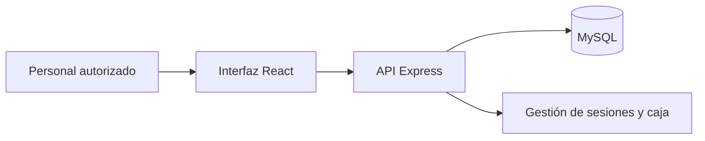

# CRAF · Sistema de gestión

**NetSol | Gestión para centro de salud | Aplicación web**

## El problema

La administración de un centro de salud requiere organizar pacientes, planes de tratamiento, sesiones, ingresos y egresos sin perder la continuidad de la atención ni la trazabilidad de los movimientos administrativos.

## La solución

**CRAF** es una aplicación web de NetSol que centraliza:

- Gestión administrativa de pacientes.
- Planes de tratamiento y seguimiento de sesiones.
- Registro de ingresos, egresos y cierres de caja.
- Reportes y suscripciones.

No se muestran datos clínicos ni información personal de pacientes.

## Arquitectura técnica

| Capa | Tecnología |
| --- | --- |
| Frontend | React 18, Vite, Bootstrap |
| API | Node.js, Express |
| Datos | MySQL |
| Despliegue web | Vercel; API en infraestructura separada |

El repositorio técnico privado documenta el frontend productivo en `craf-pilar.vercel.app` y una API bajo infraestructura de NetSol. **El código y las credenciales no se exponen en esta presentación.**

## Mi participación desde NetSol

Desarrollo y mantenimiento del sistema, implementación de cambios funcionales y trabajo sobre circuitos de sesiones, planes y gestión administrativa. Esta experiencia combina interfaz, API, datos y despliegue.

## Evidencia

- [Sitio del sistema](https://craf-pilar.vercel.app/) (puede requerir acceso).
- Existe un repositorio privado `Craf-Sistema` con instrucciones de instalación y despliegue.

## Capturas

Por tratarse de un sistema que administra información sensible, las capturas sólo deben agregarse si provienen de un entorno de demostración y no muestran pacientes reales.

---

**[Volver a los cinco proyectos](./README.md)** · **[NetSol](https://netsol.ar/)** · **[Portfolio](https://emanuel-paz-portfolio.vercel.app/)**
